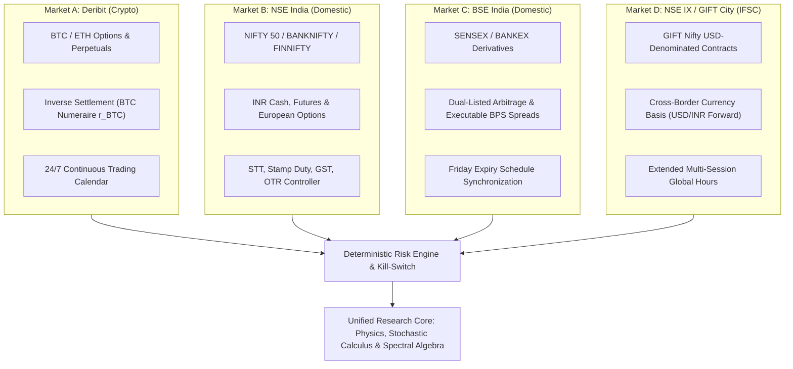

# Multi-Market Mathematical Architecture: Deribit, NSE, BSE & GIFT City (NSE IX)

## 1. Architectural Overview

`Quant_vvf` implements an institutional-grade, multi-market quantitative research and execution architecture unifying four distinct derivatives and spot trading domains:

---

## 2. Market Domain Specifications & Segregation Matrix

| Attribute | Market A: Deribit | Market B: NSE India | Market C: BSE India | Market D: GIFT City (NSE IX) |
| :--- | :--- | :--- | :--- | :--- |
| **Primary Instruments** | BTC / ETH Options & Inverse Perps | NIFTY, BANKNIFTY, Stock F&O | SENSEX, BANKEX F&O | GIFT Nifty Futures & Options |
| **Settlement Currency** | BTC / ETH (Inverse Numeraire) | INR (Rupees) | INR (Rupees) | USD (US Dollars) |
| **Trading Sessions** | 24/7/365 Continuous | 09:15 – 15:30 IST | 09:15 – 15:30 IST | 06:30 – 15:40 & 16:35 – 02:45 IST |
| **Contract Multiplier** | 1 Contract = 1 USD (or 1 BTC) | 25 (NIFTY), 15 (BANKNIFTY) | 10 (SENSEX), 15 (BANKEX) | 2 USD $\times$ Index Points |
| **Statutory Tax Framework**| Exchange Fee (0.03% taker) | STT (0.02% Fut, 0.1% Opt), Stamp, GST | STT, Stamp Duty, GST, Exchange | Zero STT/Stamp (IFSC Exemptions) |
| **Surveillance / OTR** | Rate Limits (req/sec) | SEBI OTR (Penalty > 50:1) | SEBI OTR (Penalty > 50:1) | IFSCA Algorithmic Rules |
| **Primary Pricing Engine** | Heston QE-M, Bates Jump, SVI | SABR ($\beta=1.0$), Black-76, Parity | SABR, Dual-Listed Carry Arbitrage | Cross-Border CIP Currency Basis |
