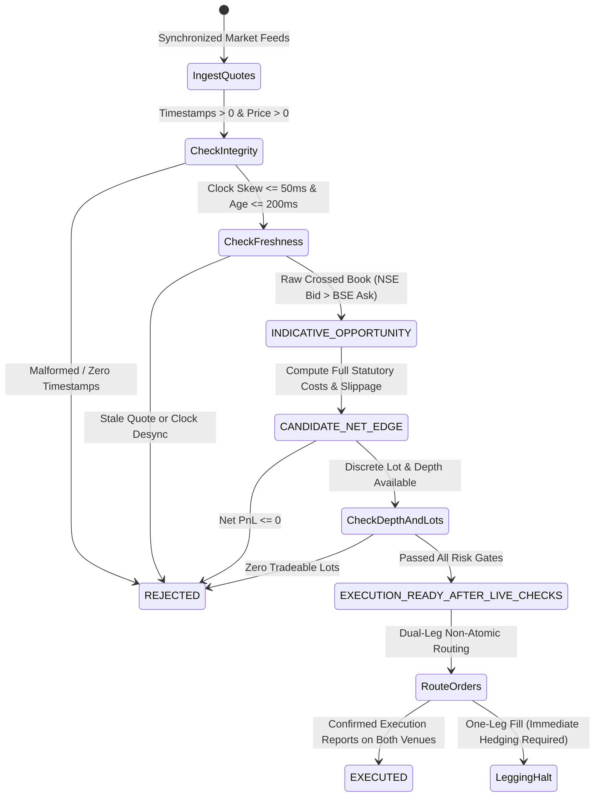

# Final Indian Cross-Exchange and Algorithmic Execution Validation

**Document Reference:** `DOC-EXEC-VALIDATION-2026-V1`  
**Target Repository:** `webspoilt/Quant_vvf`  
**Module:** `india/cross_exchange/cross_exchange_engine.py`  
**Classification:** Low-Latency Execution Architecture, Microstructure Risk Management  

---

## 1. Multi-State Execution Lifecycle Architecture

Cross-exchange trading between the National Stock Exchange (NSE) and Bombay Stock Exchange (BSE) involves independent clearing mechanisms, distinct matching engines, and separate trading network topologies.

To prevent algorithmic false positives where a superficial bid-ask inversion is mistakenly assumed to be an executable arbitrage, the execution engine implements a strict state transition model:

---

## 2. Validation Gates and Safety Policies

### 2.1 Microsecond Clock Synchronization & Skew Gates
- **Requirement**: Both legs must carry non-zero exchange timestamps.
- **Tolerance**: Maximum allowable inter-exchange clock skew is $50\text{ ms}$. If $|\tau_{\text{NSE}} - \tau_{\text{BSE}}| > 50\text{ ms}$, the engine immediately rejects the quote as stale.
- **Local Ingestion Freshness**: If local receive timestamps indicate quotes are older than $200\text{ ms}$, execution is rejected.

### 2.2 Complete Statutory Fee Verification on Both Legs
Every candidate spread must survive dual-venue statutory frictions computed via `IndiaStatutoryCostEngine`:
$$\text{Gross Profit} = (P_{\text{sell}} - P_{\text{buy}}) \times Q$$
$$\text{Total Costs} = \text{Cost}_{\text{buy}}(P_{\text{buy}}, Q, \text{Venue}_{\text{buy}}) + \text{Cost}_{\text{sell}}(P_{\text{sell}}, Q, \text{Venue}_{\text{sell}}) + \text{Slippage}(Q)$$
$$\text{Net Edge} = \text{Gross Profit} - \text{Total Costs}$$

If $\text{Net Edge} \le 0$, the state transitions to `CANDIDATE_NET_EDGE` with `is_executable = False`, preventing trading on unprofitable optical spreads.

### 2.3 Non-Atomic Routing and Legging Risk Notice
The engine explicitly flags:
> **`atomic_guarantee = False`**  
> **`disclaimer: Independent venue executions; carries residual legging and execution latency risk.`**

The terminal `EXECUTED` state is reserved exclusively for confirmed execution reports from both matching engines.
