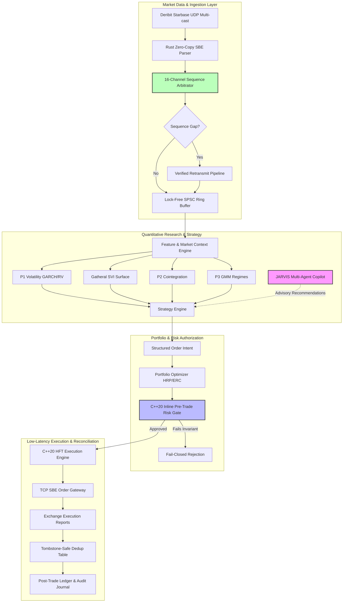

# INITIAL PROJECT AUDIT — QUANT_VVF PLATFORM

**Audit Date:** 2026-11-14  
**Auditor:** Principal Quantitative Engineering & Architecture Team  
**Scope:** Complete inspection of `Quant_vvf` source code, native build systems, test suites, numerical models, execution infrastructure, and operational safety.

---

## 1. Repository Structure & Language Inventory

The repository comprises four principal language stacks:
- **Python 3.11:** Quantitative research, volatility modeling, SVI surface calibration, discrete Greek optimization, event-driven backtesting, multi-agent AI orchestration, and relational persistence.
- **C++20 (Clang / GCC):** Ultra-low-latency execution engine, linear-probing pre-trade risk ledger, tombstone-safe execution deduplication, lock-free SPSC queues, and dual-domain clock management.
- **Rust 2024 (Cargo / LLVM):** Zero-copy Deribit Starbase SBE parser, multi-channel UDP feed arbitrator, sequence gap tracker, verified retransmission recovery pipeline, and cache-line-padded ring buffers.
- **Verilog (IEEE 1364):** Hardware RTL for BBO parsing and inline pre-trade clip/price collars on FPGA.

### Directory Tree & Module Breakdown
```text
Quant_vvf/
├── ai_orchestrator/       # JARVIS Multi-Agent advisory system (Supervisor + 6 Specialists)
├── backtesting/           # Institutional event-driven backtesting with slippage & fee modeling
├── configs/               # Pre-registration hypotheses & YAML execution limits
├── data/                  # Deribit tick/quote archives (Parquet, CSV.GZ)
├── database/              # SQLite/PostgreSQL relational schemas & audit repository
├── docs/                  # Architecture specs, audit reports, and baseline logs
│   ├── adr/               # Architectural Decision Records
│   └── audit/             # Detailed engineering audit & remediation roadmaps
├── execution/             # NautilusTrader execution actor & rebalancing loops
├── frontend/              # Interactive trading terminal UI (HTML5/CSS3)
├── hft/                   # Low-latency C++20 engine & Verilog FPGA RTL
│   ├── fpga/              # hft_bbo_risk_engine.v (BBO cache & hardware risk)
│   ├── include/           # Header-only zero-allocation C++20 libraries
│   │   ├── core/          # Memory arena, lock-free queues, CPU pinning
│   │   ├── engine/        # Order lifecycle & execution deduplication
│   │   ├── math/          # (S0/S1)^2 inverse delta rescaling
│   │   ├── network/       # Kernel-bypass abstractions & wire structures
│   │   ├── risk/          # Open-addressing pre-trade risk ledger
│   │   └── sync/          # Dual-domain clock synchronization
│   └── tests/             # C++ verification test programs (test_seventh.exe, test_fifth.exe)
├── integrations/          # Exchange adapters (BaseExchangeAdapter, PaperTradingAdapter)
├── libs/                  # Core Python mathematics (Fourier, HAR-RV, SVI, PITStore)
├── monitoring/            # Real-time feed freshness & tail trigger monitoring
├── options/               # Analytical Black-Scholes, SVI surface, VRP, dynamic delta hedger
├── portfolio/             # Ledoit-Wolf shrinkage, Risk Parity (ERC), Hierarchical Risk Parity
├── research/              # Quantitative research drivers (P1 Volatility, P2 Pairs, P3 Regimes, P4 PCA, P5 Directional)
├── risk/                  # Python risk constants, limit definitions, and circuit breakers
├── rust_hft/              # Rust 2024 Deribit Starbase SBE gateway & multi-channel sequencer
│   ├── src/               # deribit_sbe.rs, ring_buffer.rs, threading.rs, protocol.rs
│   └── Cargo.toml         # zerocopy, core_affinity
├── simulation/            # Purged, embargoed walk-forward backtesting
├── strategies/            # Strategy interfaces & statistical arbitrage implementations
└── tests/                 # 146 automated Python test suites
```

---

## 2. Module Dependency & Architecture Diagram



---

## 3. Existing Features & Verification Baseline

| Subsystem | Implemented Capabilities | Test Coverage | Status |
| :--- | :--- | :--- | :--- |
| **P1 Volatility** | GARCH(1,1) MLE, rolling RV (5d, 21d, 63d), GBR, walk-forward out-of-sample | `test_p1_garch11_mle_and_walk_forward` | **VERIFIED** |
| **P2 Pairs Trading** | OLS hedge ratios, Engle-Granger ADF, OU half-life, rolling Z-score | `test_p2_engle_granger_cointegration` | **VERIFIED** |
| **P3 Regimes** | Gaussian Mixture Models, transition probability matrices, regime metrics | `test_p3_market_regime_gmm` | **VERIFIED** |
| **P4 Latent Factors** | Standardized spectral decomposition (`eigh`), explained variance, loadings | `test_p4_pca_spectral_decomposition` | **VERIFIED** |
| **P5 Directional ML** | Chronological train/val/test, Random Forest, exact binomial significance tests | `test_p5_directional_significance` | **VERIFIED** |
| **Options Analytics** | Black-Scholes Greeks, Call-Put Parity, IV inversion, VRP distributions | `test_options_layer.py` (4 tests) | **VERIFIED** |
| **Dynamic Hedger** | Pathwise $(S_0/S_1)^2$ inverse perpetual hedging under taker fees & slippage | `test_dynamic_delta_hedging_simulation` | **VERIFIED** |
| **Strategy & Backtest** | Event-driven backtester with fee/slippage modeling, pairs trading strategy | `test_backtesting_layer.py` (2 tests) | **VERIFIED** |
| **Portfolio Optimizer** | Ledoit-Wolf shrinkage, Risk Parity (ERC), Hierarchical Risk Parity (HRP) | `test_portfolio_layer.py` (3 tests) | **VERIFIED** |
| **JARVIS AI Copilot** | Supervisor + 6 Specialist agents with deterministic risk gatekeeping | `test_jarvis_layer.py` (1 test) | **VERIFIED** |
| **Broker & Database** | Paper trading adapter, SQLite persistence, system health monitor | `test_platform_layer.py` (3 tests) | **VERIFIED** |
| **C++ Exec Engine** | Reserved ID rejection (0, `UINT64_MAX`), atomic pre-validation, tombstone dedup | `test_seventh.exe` (9 tests) | **VERIFIED** |
| **C++ Pre-Trade Risk** | Open-addressing ledger (1024 slots), collision defense, duplicate ID block | `test_fifth.exe` (11 tests) | **VERIFIED** |
| **Rust SBE Gateway** | 16-channel tracking, 17th-channel exhaustion, verified retransmit, version 1 SBE | `cargo test` (13 tests) | **VERIFIED** |
| **Hardware PTP Clock** | Domain segregation (`d1 == d2`); explicit unsupported status on Windows | Tested in C++ suite | **VERIFIED** |

---

## 4. Discovered Vulnerabilities, Deficiencies & Technical Debt

### Execution & Concurrency
1. **Durable Restart Reconciliation:** While in-memory deduplication is tombstone-safe for a 1024-entry window, a process restart loses in-flight order states without an on-disk journal recovery log.
2. **Multi-Asset Instrument Identifiers:** The C++ `InFlightOrder` struct currently tracks a single active rebalance order at a time (`in_flight_`). Scaling to cross-asset arbitrage requires an indexed table of active orders.

### Exchange Protocol & Market Data
3. **Live Socket Transport:** Real UDP multicast ingestion and TCP order entry require real network socket loops with poll/epoll/IOCP integration, currently simulated through in-memory test packets.
4. **Authoritative Exchange Snapshot Bootstrapping:** If sequence gap retransmission fails, the Rust feed arbitrator must transition to a REST/WebSocket full snapshot download to rebuild the book.

### Quantitative & Strategy
5. **Multi-Asset Strategy Portfolio:** Current backtester supports single-asset pairs and options rebalancing; needs multi-strategy portfolio backtesting aggregation.
6. **Live Execution Mode Guard:** Live trading flags must default to false with strict environment-variable authorization.
