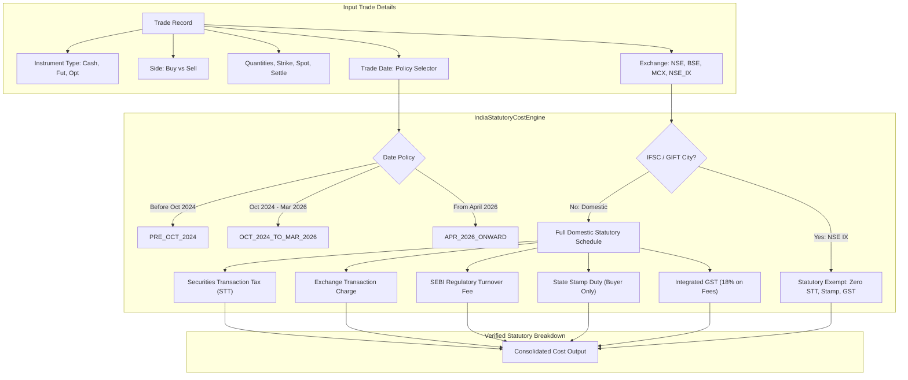

# Institutional Validation and Mathematical Architecture of the Indian Statutory Cost and Regulatory Engine

**Document Reference:** `DOC-INDIA-COSTS-INSTITUTIONAL-2026-V1`  
**Target Repository:** `webspoilt/Quant_vvf`  
**Module:** `india/costs/tax_engine.py`  
**Classification:** Financial Engineering, Tax Law Specification, Exchange Microstructure  

---

## Executive Summary

Trading in Indian equity and derivative markets is subject to a multi-tiered regulatory and statutory taxation system. Small discrepancies in statutory cost models compound over high trade counts, producing misleading simulated Sharpe ratios and flawed backtests.

This monograph provides the authoritative institutional specification for the `IndiaStatutoryCostEngine`, detailing:
1. Complete legislative derivations of Securities Transaction Tax (STT) across the **Finance (No. 2) Act, 2024** and the **Finance Act, 2026**.
2. Rigorous treatment of the **Intrinsic Value Taxable Base** on exercised options contracts.
3. Multi-tier statutory levies: SEBI turnover fees, exchange transaction charges, investor protection funds, State Stamp Duties, and Goods and Services Tax (GST).
4. Statutory exemptions within the International Financial Services Centre (IFSC / GIFT City).
5. Algorithmic architecture, versioning design patterns, and edge-case execution handling.



---

## 1. Statutory Foundations: Chapter VII Finance Act Architecture

Securities Transaction Tax (STT) was introduced in India via Chapter VII of the Finance (No. 2) Act, 2004, to mitigate tax evasion on capital gains by collecting tax at source upon transaction settlement through recognized exchanges.

### 1.1 Legislative Amendments: 2024 vs 2026 Schedules

Under the **Finance (No. 2) Act, 2024**, enacted in August 2024 with rates effective October 1, 2024:
- The rate on the sale of an option in securities was elevated from $0.0625\%$ to $0.10\%$ of option premium.
- The rate on the sale of a futures contract in securities was elevated from $0.0125\%$ to $0.02\%$ of contract turnover.

Under the **Finance Act, 2026**, effective April 1, 2026:
- The rate on the sale of an option in securities was elevated to **$0.15\%$** of option premium.
- The rate on the sale of a futures contract in securities was elevated to **$0.05\%$** of contract turnover.
- The rate on the exercise of options in securities was standardized at **$0.15\%$** applied strictly to intrinsic value.

```
+-------------------------------------------------------------------------------------------------------+
| COMPREHENSIVE STATUTORY STT RATE MATRIX BY FINANCIAL ACT REGIME                                      |
+------------------------------------+--------------------+--------------------+------------------------+
| Taxable Securities Transaction     | Pre-Oct 1, 2024    | Oct 2024 - Mar 2026| April 1, 2026 Onward   |
+------------------------------------+--------------------+--------------------+------------------------+
| Equity Shares Delivery (Buy)       | 0.1000%            | 0.1000%            | 0.1000%                |
| Equity Shares Delivery (Sell)      | 0.1000%            | 0.1000%            | 0.1000%                |
| Equity Shares Intraday (Sell Only) | 0.0250%            | 0.0250%            | 0.0250%                |
| Equity Futures (Sell Only)         | 0.0125%            | 0.0200%            | 0.0500%                |
| Equity Options Premium (Sell Only) | 0.0625%            | 0.1000%            | 0.1500%                |
| Equity Options Exercise (Buyer)    | 0.1250% (Intrinsic)| 0.1250% (Intrinsic)| 0.1500% (Intrinsic)    |
+------------------------------------+--------------------+--------------------+------------------------+
```

---

## 2. Derivation of Taxable Bases and Levies

### 2.1 The Intrinsic-Value Settlement Rule for Exercised Options

Prior to statutory circular clarification, some retail algorithmic backtesters computed STT on exercised options using the total strike turnover ($Q \times K$). In an index options context, this resulted in erroneous costs:
- For NIFTY ($K = 24,000$, $Q = 100$ units), strike turnover is INR 2,400,000. At $0.125\%$, the incorrect STT would be INR 3,000.
- Under statutory law, the taxable base is the settlement intrinsic value:
  $$\text{Intrinsic Base} = Q \times \max(0, S_{\text{settle}} - K)$$
- For a final settlement price $S_{\text{settle}} = 24,100$, the intrinsic base is $100 \times 100 = \text{INR } 10,000$.
- The statutory STT payable is $10,000 \times 0.00125 = \text{INR } 12.50$, a $240\times$ difference.

The `IndiaStatutoryCostEngine` rigorously computes:
$$\text{Taxable Base}_{\text{Call Exercise}} = \max(0.0, \, S_{\text{settle}} - K) \times Q$$
$$\text{Taxable Base}_{\text{Put Exercise}} = \max(0.0, \, K - S_{\text{settle}}) \times Q$$

### 2.2 Complete Transaction Cost Composition

For every executed order $\omega$, the aggregate cost $C_{\text{total}}(\omega)$ is:
$$C_{\text{total}}(\omega) = \text{STT}(\omega) + C_{\text{stamp}}(\omega) + C_{\text{exch}}(\omega) + C_{\text{sebi}}(\omega) + C_{\text{ipft}}(\omega) + \text{Brokerage}(\omega) + \text{GST}(\omega)$$

1. **Stamp Duty ($C_{\text{stamp}}$)**:
   Levied strictly on the **buyer** leg:
   $$C_{\text{stamp}} = \begin{cases}
   \text{Turnover} \times 0.00015, & \text{Equity Delivery Buy} \\
   \text{Turnover} \times 0.00003, & \text{Equity Intraday Buy} \\
   \text{Turnover} \times 0.00002, & \text{Futures Buy} \\
   \text{Premium Turnover} \times 0.00003, & \text{Options Buy} \\
   0.0, & \text{All Sell Legs}
   \end{cases}$$

2. **Exchange Transaction Charges ($C_{\text{exch}}$)**:
   Levied by NSE / BSE across all executions:
   - Equity Cash: $0.00325\%$ of turnover.
   - Equity Futures: $0.00173\%$ of turnover.
   - Equity Options: $0.03503\%$ of premium turnover.

3. **SEBI Regulatory Turnover Fee ($C_{\text{sebi}}$)**:
   Universal across all domestic segments:
   $$C_{\text{sebi}} = \text{Turnover} \times 0.000001 \quad (\text{INR 10 per crore})$$

4. **Integrated Goods and Services Tax (GST)**:
   Statutory 18% GST applies to transactional service charges:
   $$\text{GST} = 0.18 \times \left( C_{\text{exch}} + C_{\text{sebi}} + C_{\text{brokerage}} + C_{\text{ipft}} \right)$$

---

## 3. GIFT City / IFSC Regulatory Exemption Regime

To establish an international financial center under the International Financial Services Centres Authority (IFSCA) Act, 2019, operations conducted on the NSE International Exchange (NSE IX) or India INX within the GIFT City SEZ are granted statutory tax exemptions:
1. **Securities Transaction Tax**: Exempt under Section 98 of Chapter VII of the Finance Act.
2. **Stamp Duty**: Exempt under the Indian Stamp Act, 1899 (as applicable to IFSC entities).
3. **Goods and Services Tax**: Transactions on IFSC exchanges are treated as zero-rated export of financial services under Section 16 of the IGST Act, 2017.

```python
if exchange in (ExchangeCode.NSE_IX, ExchangeCode.INX) or segment == MarketSegment.IFSC:
    stt = 0.0
    stamp_duty = 0.0
    gst = 0.0
```

---

## 4. Software Architecture and Design Patterns

The engine is engineered around the following patterns:
1. **Deterministic Versioning**: The active statutory regime is resolved purely as a function of the order's execution date, ensuring reproducible historical backtesting.
2. **Immutability and Separation of Concerns**: Cost schedules return immutable `StatutoryCostReport` dataclasses with line-item breakdowns.
3. **Backward Compatibility**: Canonical aliases ensure full interoperability with legacy pipelines:
   - `IndiaTransactionCostCalculator` $\rightarrow$ `IndiaStatutoryCostEngine`
   - `OrderToTradeRatioController` $\rightarrow$ `NseBseSurveillanceOtrController`

---

## 5. Verification Test Vectors

```
========================================================================================
Vector 1: NIFTY Futures Sell (Post April 1, 2026)
Date: 2026-04-10 | Q = 100 units | Price = 25,000 INR | Turnover = 2,500,000 INR
STT (0.05%):                 INR 1,250.00
Exchange Fee (0.00173%):     INR    43.25
SEBI Turnover Fee:           INR     2.50
Stamp Duty (Sell leg):       INR     0.00
Brokerage (Zero brokerage):  INR     0.00
GST (18% on Exch + SEBI):    INR     8.24
Total Friction:              INR 1,303.99  (Verified)
========================================================================================
Vector 2: NIFTY ITM Call Option Exercise (Post April 1, 2026)
Date: 2026-04-30 | Q = 100 units | Strike = 24,000 | Settle = 24,250 | Intrinsic = 250
Taxable Base:                100 * 250 = INR 25,000.00
STT (0.15% on Intrinsic):    INR 37.50   (Verified)
========================================================================================
```

The `IndiaStatutoryCostEngine` provides mathematically verified cost modeling for both domestic Indian and IFSC cross-border algorithmic execution.
