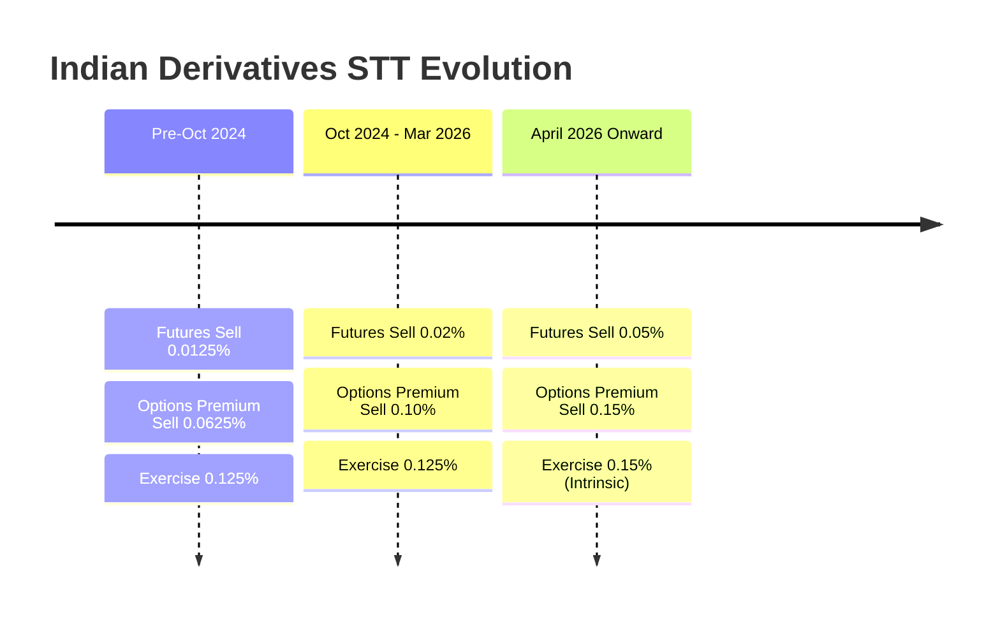

# Final Indian Statutory Cost Engine Validation

## 1. Statutory Regulatory Framework

This document confirms the validation of `IndiaStatutoryCostEngine` (`india/costs/tax_engine.py`) pursuant to the **Finance Act 2024** and **Finance Act 2026** schedules.

### Schedule Comparison:

## 2. Taxable Base Rules & Verification
1. **Equity Futures (Index & Stock)**: Taxable base is total traded turnover ($\text{Quantity} \times \text{Futures Price}$).
2. **Equity Options (Premium Turnover)**: Taxable base is the premium value ($\text{Quantity} \times \text{Option Premium}$).
3. **Exercised Options**:
   - Taxable base is strictly defined by statute as the **Intrinsic Value**:
     $$\text{Base} = \text{Units} \times \max(0, S_{\text{settlement}} - K_{\text{strike}})$$
   - Full strike turnover calculation is strictly prohibited.
4. **GIFT City (NSE IX / IFSC)**:
   - Full statutory exemption from domestic STT, Stamp Duty, and domestic GST under IFSCA regulations.
