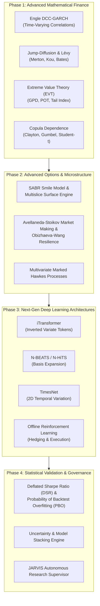

# QUANT_VVF — ADVANCED RESEARCH ROADMAP & MODEL GAP ANALYSIS

**Architecture Milestone:** Research-Grade Mathematical Finance & Deep Learning Platform  
**Target Domain:** Deribit Institutional BTC Options, Inverse Perpetuals & Microstructure Execution  

---

## 1. Implementation Roadmap by Controlled Phases

---

## 2. Priority 1 — Mathematical Finance Gaps to Implement

1. **DCC-GARCH (Engle 2002):**
   - Stage 1: Fit univariate GARCH(1,1) to each asset $i \in \{1, \dots, N\}$.
   - Stage 2: Standardize residuals $\varepsilon_{i,t} = r_{i,t} / \sigma_{i,t}$.
   - Stage 3: Dynamic correlation tracking:
     $$Q_t = (1 - a - b)\bar{Q} + a (\boldsymbol{\varepsilon}_{t-1} \boldsymbol{\varepsilon}_{t-1}^T) + b Q_{t-1}$$
     $$R_t = \operatorname{diag}(Q_t)^{-1/2} Q_t \operatorname{diag}(Q_t)^{-1/2}$$
2. **Jump-Diffusion Models:**
   - **Merton (1976):** Normal jump sizes with Poisson arrival intensity $\lambda$.
   - **Kou (2002):** Double exponential asymmetric jump sizes capturing memoryless crash dynamics.
   - **Bates (1996):** Stochastic volatility (Heston) + Merton jump diffusion.
3. **Extreme Value Theory (EVT):**
   - Generalized Pareto Distribution (GPD) for Peaks Over Threshold (POT):
     $$G_{\xi, \sigma}(y) = 1 - \left(1 + \frac{\xi y}{\sigma}\right)^{-1/\xi}$$
   - Analytical Value-at-Risk and Expected Shortfall under heavy tails.
4. **Copulas:**
   - Clayton (lower tail dependence), Gumbel (upper tail dependence), and Student-$t$ (symmetric fat-tailed co-movement).

---

## 3. Priority 2 — Advanced Microstructure & Execution Gaps

1. **Avellaneda & Stoikov (2008):**
   - High-frequency market-making with inventory penalty:
     $$r(s, q, t) = s - q \gamma \sigma^2 (T - t)$$
     $$\delta^a + \delta^b = \gamma \sigma^2 (T - t) + \frac{2}{\gamma} \ln\left(1 + \frac{\gamma}{\kappa}\right)$$
2. **Obizhaeva & Wang (2013):**
   - Transient price impact with exponential resilience kernel $e^{-\rho (t-s)}$.

---

## 4. Priority 3 — Next-Gen Deep Learning Gaps

1. **iTransformer (Liu et al. ICLR 2024):**
   - Inverted variate tokens where individual time-series channels are projected into tokens, and self-attention captures multivariate inter-series correlations.
2. **N-BEATS (Oreshkin et al. ICLR 2020):**
   - Deep neural architecture of backward and forward residual basis expansion blocks for interpretable trend and seasonality forecasting.
3. **Statistical Validation (Bailey & López de Prado 2014):**
   - Deflated Sharpe Ratio (DSR) correcting for multiple hypothesis testing and non-normality:
     $$\operatorname{DSR} = \Phi\left(\frac{(\widehat{\mathrm{SR}} - \mathrm{SR}_0)\sqrt{T-1}}{\sqrt{1 - \hat{\gamma}_3 \widehat{\mathrm{SR}} + \frac{\hat{\gamma}_4 - 1}{4}\widehat{\mathrm{SR}}^2}}\right)$$
