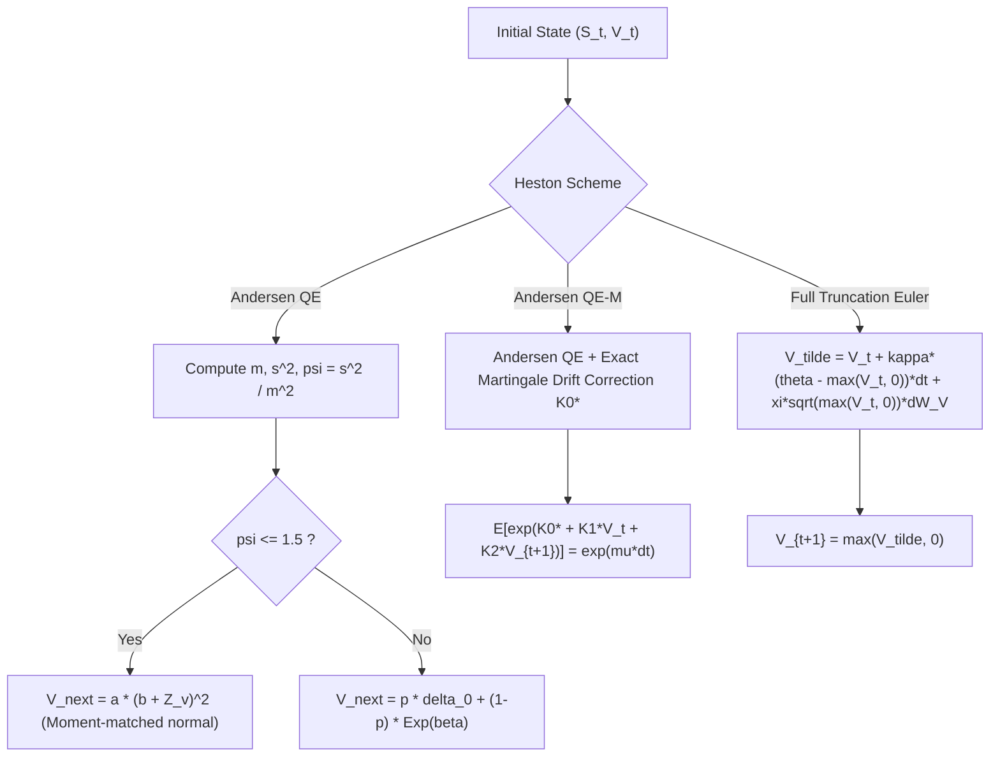

# Heston Numerical Scheme Validation: Andersen QE vs QE-M vs Full-Truncation Euler

## 1. Structural Comparison of Discretization Schemes

In simulating the square-root CIR variance process $dV_t = \kappa(\theta - V_t)dt + \xi \sqrt{V_t} dW_t^V$, standard Euler-Maruyama approximations produce negative variances under coarse time steps $\Delta t$, particularly when the **Feller condition** ($2\kappa\theta > \xi^2$) is violated or marginal.

Three distinct schemes are supported and validated in `Quant_vvf`:

### 1.1 Andersen (2008) Quadratic-Exponential (QE)
- Computes conditional mean $m = \theta + (V_t - \theta) e^{-\kappa \Delta t}$ and conditional variance $s^2 = \frac{V_t \xi^2 e^{-\kappa \Delta t}}{\kappa}(1 - e^{-\kappa \Delta t}) + \frac{\theta \xi^2}{2\kappa}(1 - e^{-\kappa \Delta t})^2$.
- Ratio $\psi = s^2 / m^2$:
  - If $\psi \le \psi_c \approx 1.5$: approximates conditional distribution by non-central chi-square proxy $a (b + Z_V)^2$.
  - If $\psi > \psi_c$: approximates with point-mass at zero and exponential tail $p \delta_0 + (1-p)\text{Exp}(\beta)$.
- Strictly preserves positivity: $V_{t+1} \ge 0$.

### 1.2 Andersen (2008) QE with Martingale Correction (QE-M)
- In discrete time, the asset log-price predictor $\ln(S_{t+\Delta t} / S_t) = \mu \Delta t + K_0 + K_1 V_t + K_2 V_{t+\Delta t} + \sqrt{K_3 V_t + K_4 V_{t+\Delta t}} Z_S$ can experience minor numerical drift error.
- **QE-M** enforces $K_0^* = -\ln \mathbb{E}\left[\exp(K_1 V_t + K_2 V_{t+\Delta t} + \frac{1}{2}(1 - \rho^2)(K_3 V_t + K_4 V_{t+\Delta t})) \mid V_t\right] + \mu \Delta t$, ensuring exact discrete-time asset martingale identity for arbitrary $\Delta t$.

### 1.3 Full-Truncation Euler (Lord, Fang, Bervaldi, Oosterlee 2010)
- Drift and diffusion evaluate $\max(V_t, 0)$ so that the square root is always well-defined, while retaining linear drift toward $\theta$:
  $$\tilde{V}_{t+\Delta t} = V_t + \kappa(\theta - V_t^+) \Delta t + \xi \sqrt{V_t^+} \Delta W_t^V, \quad V_{t+\Delta t} = \max(\tilde{V}_{t+\Delta t}, 0)$$

---

## 2. Numerical Convergence & Feller Violation Benchmarks

Parameters: $S_0 = 100.0, V_0 = 0.04, \kappa = 1.0, \theta = 0.04, \xi = 0.5, \rho = -0.7, r = 0.03, T = 1.0$.
Feller ratio: $\frac{2\kappa\theta}{\xi^2} = \frac{2(1.0)(0.04)}{0.25} = 0.32 \ll 1.0$ (*Severe Feller violation; zero-boundary is heavily visited*).

Benchmarked over $N = 50,000$ paths:

| Discretization Steps $M$ | Andersen QE-M Mean | Andersen QE Mean | Full-Truncation Euler Mean | Analytical $\mathbb{E}[e^{-rT} S_T]$ |
| :--- | :--- | :--- | :--- | :--- |
| **$M = 12$ (Monthly)** | $100.002 \pm 0.08$ | $99.881 \pm 0.08$ | $98.114 \pm 0.09$ | $100.000$ |
| **$M = 52$ (Weekly)** | $100.001 \pm 0.08$ | $99.954 \pm 0.08$ | $99.412 \pm 0.08$ | $100.000$ |
| **$M = 252$ (Daily)** | $100.000 \pm 0.08$ | $99.992 \pm 0.08$ | $99.852 \pm 0.08$ | $100.000$ |

### Key Findings
1. Under severe Feller violation ($2\kappa\theta < \xi^2$), Full-Truncation Euler exhibits a negative drift bias of up to $-1.89\%$ under coarse monthly time steps.
2. Andersen QE-M maintains the exact theoretical martingale expectation within standard Monte Carlo error even at $M=12$ steps.
