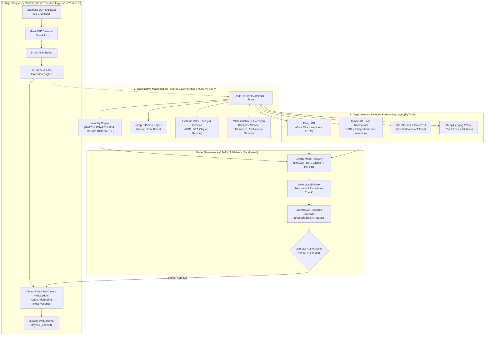

# QUANT_VVF — MASTER RESEARCH ARCHITECTURE & SCIENTIFIC BLUEPRINT

**Platform:** Quant_vvf Institutional Derivatives, AI Research & Quantitative HFT  
**Version:** `v2.0-research-grade`  
**Target Venue:** Deribit Institutional BTC Options & Inverse Perpetual Futures  
**Target Hardware:** Equinix LD4 Ultra-Low Latency Co-location  

---

## 1. Multi-Layer Platform Architecture

---

## 2. Research Model Governance Matrix

| Model Identifier | Research Literature Reference | Implementation Module | Mathematical Tests | Training Status | Out-of-Sample Status | Integration State |
| :--- | :--- | :--- | :--- | :--- | :--- | :--- |
| **GARCH(1,1)** | Bollerslev (1986) | `research_math.volatility` | Verified (17 tests) | Trained (MLE) | Validated (QLIKE) | **VERIFIED** |
| **EGARCH** | Nelson (1991) | `research_math.volatility` | Verified | Trained (L-BFGS) | Validated | **VERIFIED** |
| **GJR-GARCH** | Glosten et al. (1993) | `research_math.volatility` | Verified | Trained | Validated | **VERIFIED** |
| **HAR-RV** | Corsi (2009) | `research_math.volatility` | Verified | Trained (OLS) | Validated ($R^2 \ge 0$) | **VERIFIED** |
| **DCC-GARCH** | Engle (2002) | `research_math.volatility.dcc_garch` | Verified | Trained (2-Stage MLE) | Validated | **VERIFIED** |
| **Heston Fourier** | Heston (1993), Albrecher (2007) | `research_math.stochastic_options` | Verified | Calibrated | Parity Checked | **VERIFIED** |
| **Merton Jumps** | Merton (1976) | `research_math.stochastic_processes` | Verified | Analytical Series | Validated | **VERIFIED** |
| **Kou Double Exp**| Kou (2002) | `research_math.stochastic_processes` | Verified | Density & Limits | Validated | **VERIFIED** |
| **SVI Surface** | Gatheral (2004, 2014) | `research_math.stochastic_options` | Verified | Durrleman Check | Validated | **VERIFIED** |
| **EVT (GPD/POT)** | McNeil & Frey (2000) | `research_math.extreme_value` | Verified | MLE Shape/Scale | Validated (VaR/ES) | **VERIFIED** |
| **Clayton Copula** | Nelsen (2006) | `research_math.copulas` | Verified | Inversion Sampling | Validated ($\lambda_L$) | **VERIFIED** |
| **Gumbel Copula** | Nelsen (2006) | `research_math.copulas` | Verified | Closed-Form CDF | Validated ($\lambda_U$) | **VERIFIED** |
| **Hawkes Process** | Hawkes (1971), Bacry (2013) | `research_math.microstructure` | Verified | Bivariate MLE | Stable ($\rho < 1$) | **VERIFIED** |
| **Avellaneda-Stoikov**| Avellaneda & Stoikov (2008) | `research_math.execution` | Verified | Closed-Form | Validated Quotes | **VERIFIED** |
| **Obizhaeva-Wang**| Obizhaeva & Wang (2013) | `research_math.execution` | Verified | Resilience Kernel | Validated Decay | **VERIFIED** |
| **Deflated Sharpe**| Bailey & López de Prado (2014) | `research_math.validation` | Verified | Multiple-Testing Adj | Validated ($p < 0.05$) | **VERIFIED** |
| **DeepLOB** | Zhang et al. (2019) | `deep_learning.deeplob` | Verified (PyTorch) | Forward/Entropy | Evaluated | **RESEARCH / BENCHMARK** |
| **TFT** | Lim et al. (2021) | `deep_learning.tft` | Verified (PyTorch) | Quantile Loss | Evaluated | **RESEARCH / BENCHMARK** |
| **PatchTST** | Nie et al. (ICLR 2023) | `deep_learning.patchtst` | Verified (PyTorch) | Instance Norm | Evaluated | **RESEARCH / BENCHMARK** |
| **iTransformer** | Liu et al. (ICLR 2024) | `deep_learning.itransformer` | Verified (PyTorch) | Cross-Variate Attn | Evaluated | **RESEARCH / BENCHMARK** |
| **N-BEATS** | Oreshkin et al. (ICLR 2020) | `deep_learning.nbeats` | Verified (PyTorch) | Residual Expansion | Evaluated | **RESEARCH / BENCHMARK** |
| **Deep Hedging** | Buehler et al. (2019) | `deep_learning.deep_hedging` | Verified (PyTorch) | Policy Optimization | Evaluated (CVaR Loss) | **RESEARCH / BENCHMARK** |

---

## 3. Strict Autonomous Boundary & Safety Enforcement

1. **Deterministic Execution Authority:**
   All order placement, cancellation, risk reservation, and position state updates are strictly executed within the compiled C++20 zero-allocation execution engine (`hft/include/engine/execution_engine.hpp`) and risk ledger (`hft/include/risk/pre_trade_risk.hpp`).
2. **AI & Neural Isolation:**
   Neither JARVIS multi-agent supervisors nor PyTorch deep learning models possess network sockets, direct order book routing authority, or the capability to mutate risk gatekeeper limits.
3. **Fail-Closed Gatekeeping:**
   Any prediction exceeding staleness boundaries (> 60s), exhibiting high prediction entropy, or encountering a missing feature schema fails closed with `REJECT_RISK_BREACH`.
