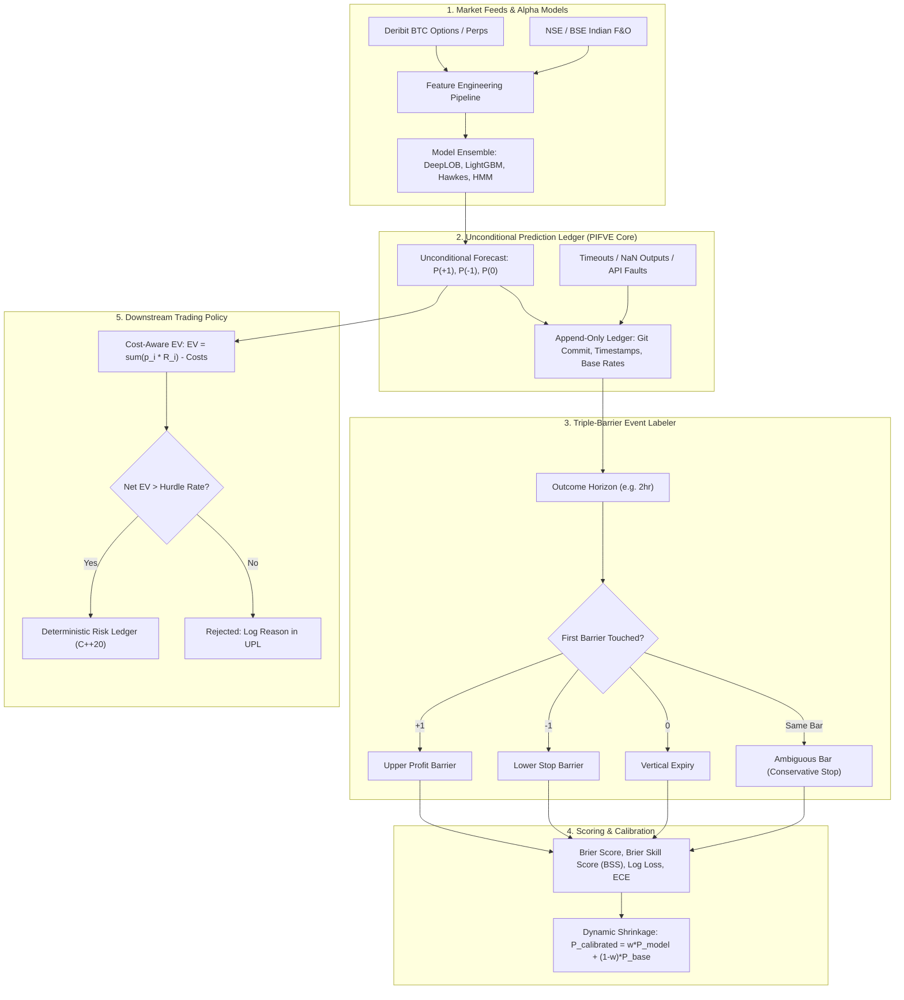

# Predictive Intelligence & Forward Validation Engine (PIFVE) Architecture

## 1. Executive Summary

The **Quant_vvf Predictive Intelligence & Forward Validation Engine (PIFVE)** decouples model skill evaluation from trading policy execution.

A fundamental flaw in naive quantitative research is evaluating model predictions only on executed trades:
- A model can have genuine predictive skill, yet the downstream trading policy rejects its signals due to risk or execution gates (e.g., negative expected value, excessive spread, margin caps).
- Conversely, an unskillful model can appear profitable over a small sample of executed trades due to lucky execution timing.

PIFVE resolves this by establishing an **Unconditional Prediction Ledger (UPL)**: every model forecast is recorded before downstream filtering, evaluated against ground-truth triple-barrier outcomes once mature, and scored using strictly proper scoring rules.

---

## 2. Four Central Components

### 2.1 Unconditional Prediction Ledger (`research/pifve/prediction_ledger/`)
- Records:
  - Prediction ID (UUID).
  - Model ID, model version, and git commit hash.
  - Market venue (`DERIBIT`, `NSE`, `BSE`, `NSE_IX`) and instrument identifier.
  - Raw probabilities: $P(+1), P(-1), P(0)$.
  - Calibrated probabilities and historical base rates.
  - Feature snapshot ID and prediction timestamp.
  - Forecast horizon duration (seconds/bars).
  - Downstream decision policy action (`EXECUTED`, `REJECTED_EXPECTED_VALUE`, `REJECTED_RISK_LIMIT`, `REJECTED_OTR_LIMIT`, `SHADOW_OBSERVATION_ONLY`).
  - Operational failures (logged as explicit failure events, never silently dropped).

### 2.2 Triple-Barrier Method & Ground Truth Labeling (`research/pifve/triple_barrier/`)
- Based on Marcos López de Prado (2018):
  - **Upper Barrier**: $S_t \times (1 + \text{pt} \times \sigma_t)$
  - **Lower Barrier**: $S_t \times (1 - \text{sl} \times \sigma_t)$
  - **Vertical Barrier**: Horizon expiry $t + \Delta \tau$
- **Ambiguous Bar Safeguard**: If both upper and lower barriers are crossed within a single candlestick, marks `AMBIGUOUS_BAR` and applies a conservative worst-case stop convention.

### 2.3 Probability Evaluation, Proper Scoring & Calibration (`research/pifve/probability_evaluation/`)
- **Multi-Class Brier Score**:
  $$BS = \frac{1}{N} \sum_{i=1}^N \sum_{k=1}^K (p_{ik} - y_{ik})^2$$
- **Log Loss**:
  $$LL = -\frac{1}{N} \sum_{i=1}^N \sum_{k=1}^K y_{ik} \ln(\max(\epsilon, p_{ik}))$$
- **Brier Skill Score (BSS)**:
  $$BSS = 1 - \frac{BS_{\text{model}}}{BS_{\text{base}}}$$
- **Expected Calibration Error (ECE)** & Reliability Diagrams.
- **Dynamic Chronological Calibration**:
  $$P_{\text{calibrated}} = w P_{\text{model}} + (1 - w) P_{\text{base}}$$
  where $w$ is fitted exclusively on previously matured outcomes.

### 2.4 Forward Validation, Independent Horizons & Cost-Aware EV (`research/pifve/forward_validation/`)
- **Independent Horizon Filtering**: Purges overlapping event intervals to report effective independent sample size $N_{\text{eff}}$, eliminating autocorrelation bias.
- **Cost-Aware Economic Expected Value**:
  $$EV = P(\text{Upper}) \mathbb{E}[R_U] + P(\text{Lower}) \mathbb{E}[R_L] + P(\text{Vertical}) \mathbb{E}[R_V] - \mathbb{E}[\text{Costs}]$$
  Signals proceed to execution only if net expected value exceeds the venue statutory cost schedule plus hurdle rate.
- **Champion / Challenger Model Arena**: Evaluates multiple candidate models head-to-head on the identical forecast event stream.
