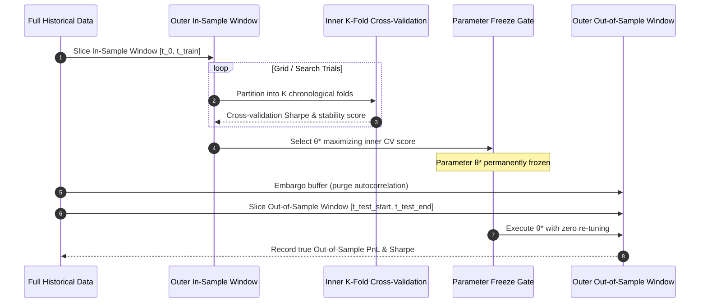

# Nested Walk-Forward Optimization & Out-of-Sample Protocol

## 1. Methodological Architecture

Standard Walk-Forward Optimization (WFO) often suffers from selection bias when the best parameters found on the in-sample window are tested directly on out-of-sample data. If parameters are selected based on the same window used to evaluate them, overfitting persists.

`Quant_vvf` implements **Nested Walk-Forward Optimization (Nested WFO)** in `backtesting/walk_forward/nested_wfo.py`:

---

## 2. Key Defect Remediations & Mitigations

### 2.1 Chronological K-Fold Inner Validation
- Cross-validation inside the training window preserves temporal order (no randomized shuffling, preventing lookahead leakage).
- Inner folds evaluate parameter robustness across distinct sub-regimes before promotion.

### 2.2 Strict Parameter Freezing
- Once optimal hyperparameter vector $\theta^*$ is selected by the inner CV loop, it is strictly frozen.
- No tuning, early stopping, or threshold modification is permitted during evaluation on the outer test set $[t_{\text{test\_start}}, t_{\text{test\_end}}]$.

### 2.3 Embargo and Purging
- An explicit embargo buffer of size $L_{\text{embargo}}$ (default: 5 bars or holding period equivalent) is placed between `train_end` and `test_start`.
- Purges residual serial autocorrelation and autoregressive feature overlap between the training set and test set.

### 2.4 Multi-Trial Correction Integration
- All parameter trials explored during the nested inner loops are aggregated into the Deflated Sharpe Ratio calculation:
  $$N_{\text{trials}} = |\Theta| \times W_{\text{windows}}$$
  preventing multiple-testing false discoveries.
